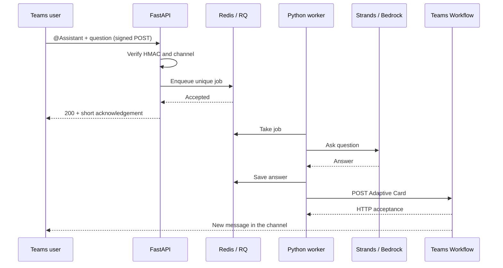

# Reactive and Proactive AI Agents in Microsoft Teams with Python and Strands

I wanted to connect an AI agent to a Microsoft Teams channel. Someone mentions the assistant, the agent does its work, and the answer appears in Teams. I also wanted the opposite direction: an event starts the agent, and the agent posts a message without waiting for someone to ask.

There was a practical constraint: I could configure an Outgoing Webhook, but I did not have administrator support to register a Teams bot with its application credentials. So this PoC uses an Outgoing Webhook for input and a Teams Workflow for output, with Python, FastAPI, Redis and Strands Agents in between.

The first problem appears before we even call the model. Teams gives an Outgoing Webhook **five seconds** to respond. A model invocation can take longer than that, especially when the agent uses tools. Outgoing Webhooks also work through mentions in public channels, rather than private chats. These are [properties of the Teams integration](https://learn.microsoft.com/en-us/microsoftteams/platform/webhooks-and-connectors/how-to/add-outgoing-webhook), so making the Python endpoint asynchronous does not remove them.

## Two directions, two connections

An Outgoing Webhook does not give us credentials for sending a message later. Its response belongs to the original HTTP exchange. Once that exchange is over, we need another way back into Teams.

For this experiment, that second connection is a Workflow using the **When a Teams webhook request is received** trigger. It accepts an Adaptive Card and posts it to a fixed channel. Workflows provide this [HTTP-to-Teams integration](https://learn.microsoft.com/en-us/microsoftteams/platform/webhooks-and-connectors/how-to/add-incoming-webhook).



The immediate acknowledgement appears in the original reply chain. The final answer is a **new channel message**, posted by Workflows. This gives us an asynchronous exchange, with a short request identifier connecting the two messages. It does not create a private chat or a persistent conversation with a bot.

I am deliberately using Workflows rather than the old Incoming Webhook connector. Microsoft announced the [final Office 365 connector retirement rollout for May 18–22, 2026](https://devblogs.microsoft.com/microsoft365dev/retirement-of-office-365-connectors-within-microsoft-teams/). Workflows messages also use their own identity; naming the outgoing webhook “Assistant” does not turn the workflow into that same sender.

## Why not FastAPI BackgroundTasks?

My first thought was to return a response and continue processing with `BackgroundTasks`:

```python
@app.post("/webhook")
def webhook(background_tasks: BackgroundTasks):
    background_tasks.add_task(ask_agent_and_send_answer)
    return {"type": "message", "text": "Working on it"}
```

That would move the work after the HTTP response. But the task would still belong to the web process. Restart it during a deployment and there is no durable queue waiting for another process to recover the request. FastAPI's [background task documentation](https://fastapi.tiangolo.com/tutorial/background-tasks/) makes the distinction between local background work and work handled by a separate queue system.

Here I use Redis and RQ. The API acknowledges only after enqueueing succeeds. A separate worker runs the agent. We can stop the worker, keep accepting requests, and process them after it returns.

This introduces one more service, but it makes the lifetime of a request independent of the lifetime of an HTTP connection.

## Authenticate before doing any work

Teams signs the outgoing request using HMAC-SHA256. The configuration token is a base64-encoded key. The signature must be calculated over the original request bytes:

```python
def signature(body: bytes, key: bytes) -> str:
    digest = hmac.new(key, body, hashlib.sha256).digest()
    return "HMAC " + base64.b64encode(digest).decode("ascii")


def authenticated(body: bytes, authorization: str, key: bytes) -> bool:
    return hmac.compare_digest(signature(body, key).encode(), authorization.encode())
```

Parsing JSON and serializing it again could change whitespace or encoding. We verify first, then parse the activity, validate its shape, and check the tenant, team and channel against configuration.

The PoC intentionally supports one channel. The outgoing webhook is team-scoped, so accepting every channel and forwarding everything to one configured destination would be a routing bug. The workflow URL comes exclusively from configuration; neither the incoming activity nor the model can choose a destination.

When the activity provides the recipient and matching mention metadata, we remove the assistant's mention from the prompt while retaining the names of other mentioned users. Outgoing Webhooks can send `recipient: null` and only client metadata. We accept that shape too, preserving mention names as text when we cannot identify which mention belongs to the assistant.

## Acknowledgement is a queue boundary

The central part of the endpoint is small:

```python
job_id = await asyncio.wait_for(
    asyncio.to_thread(enqueue, queue, task, activity.job_id(), settings),
    timeout=2,
)
```

The synchronous Redis client runs outside the event loop. There is a separate one-second budget for reading the bounded request body. These are application budgets, leaving some room within Teams' deadline; they are not a guarantee against network delays or an overloaded deployment.

If Redis is unavailable, the endpoint returns `503` rather than telling the user that the request was queued. A timeout can still leave an ambiguous outcome: Redis may accept a job just before the API stops waiting. The deduplication key handles a later retry of the same activity.

That key is a hash of the tenant, team, channel and activity ID. The producer uses RQ's unique-job support:

```python
queue.enqueue(
    "teams_agent.jobs.run",
    task.model_dump(),
    job_id=job_id,
    unique=True,
    job_timeout=settings.job_timeout,
    result_ttl=settings.retention_seconds,
    failure_ttl=settings.retention_seconds,
    retry=Retry(max=3, interval=[10, 30, 60]),
    description=f"Teams request {job_id}",
)
```

[RQ's uniqueness constraint](https://python-rq.org/docs/#unique-jobs) lasts while the job exists. Completed and failed jobs are retained for one day by default, so this is a bounded deduplication window. Sending a new message in Teams creates a new activity and therefore a new job.

## An incident to investigate

To give the assistant something useful to do, I added a small incident simulation. In the fixed snapshot, `checkout` has a p95 latency of 840 ms against a 210 ms baseline, with a 2.4 percent error rate. Its database pool is fully occupied. Ten minutes before the snapshot, version `1.8.2` reduced the pool from 50 connections to 10; the degradation started nine minutes before the snapshot.

That gives us a hypothesis to investigate. The deployment timeline and the connection waits support checking pool contention, but they do not prove the cause. A second service, `catalog`, has metrics near its baseline, so we can also ask the agent to compare a degraded service with a healthy one.

All evidence lives in `src/teams_agent/data/incident.json`. The data is fictional and frozen: “ten minutes ago” refers to that snapshot, not the time at which someone sends a Teams message. We can inspect it directly:

```bash
poetry run teams-agent scenario
```

The agent has three Python tools:

| Tool | Evidence |
| --- | --- |
| `get_service_metrics(service)` | Current and baseline latency, error rates, pool utilization and connection wait times |
| `get_recent_deployments(service)` | Versions, changes and their position in the simulation's timeline |
| `get_runbook(service)` | Diagnostic checks, possible mitigation and its approval requirement |

Each tool reads the packaged snapshot and returns only its relevant section. For example:

```python
@tool
def get_recent_deployments(service: str) -> dict:
    """Read fictional deployment history, changes and times relative to the fixed snapshot.

    Args:
        service: Service name: checkout or catalog.
    """
    return _evidence(service, "deployments")
```

The helper looks up the service by name. An unknown service produces an explicit error and a list of available services, rather than silently returning checkout's metrics. Loading through `importlib.resources` keeps the tools independent of the working directory, including when the package runs inside a worker or container.

From Teams, the demo looks like this:

```text
@Assistant Checkout is slow. Investigate the metrics, recent deployments and runbook.
```

The webhook acknowledges the request immediately. In the worker, Strands calls the tools and uses their results to write an assessment. A possible response would be:

> Simulation: checkout's p95 latency is four times its baseline, with 2.4% errors. The pool is fully occupied and connection waits are high. The degradation follows deployment 1.8.2, which reduced the pool size. Pool contention is a plausible hypothesis. Check connection timeout logs, slow queries and database capacity before proposing an approved configuration change or rollback.

That is illustrative output, not a fixed response template. The model generates the report from the tool results.

We can ask different questions about that same evidence. In Teams, select the outgoing webhook's actual name from the mention list; `@Assistant` is the name used in these examples:

| What to explore | Example Teams message |
| --- | --- |
| Service health | `@Assistant How is checkout performing compared with its baseline?` |
| Comparison | `@Assistant Compare checkout and catalog. Which service needs investigation, and why?` |
| Recent changes | `@Assistant What changed in checkout's latest deployment, and how does it relate to the degradation timeline?` |
| Strength of the hypothesis | `@Assistant What evidence supports connection pool contention in checkout, and what still needs checking?` |
| Next steps | `@Assistant What are the first three checks you would perform for checkout?` |
| Mitigation | `@Assistant Would you recommend rolling back checkout? Explain what should be verified first.` |
| Communication | `@Assistant Summarize the checkout incident for a nontechnical audience, separating impact, hypothesis and next steps.` |
| Missing information | `@Assistant Investigate payments. What evidence is available?` |

The last question is useful too: `payments` is absent from the snapshot, so the assistant should explain that it only has data for `checkout` and `catalog`. Likewise, a question suggesting a problem in `catalog` should not make it invent one.

Each message starts an independent investigation. Include the service name and the relevant question in every request; a follow-up such as “and what changed?” has no previous conversation attached. The tools always return the same fictional snapshot, and the assistant can analyze it and propose checks without executing changes.

## The agent stays focused

The worker creates a fresh Strands Agent for each request. This PoC has no shared conversational memory, so messages from different channel users do not accidentally share an agent instance.

```python
agent = Agent(
    model=BedrockModel(
        model_id=settings.bedrock_model_id,
        boto_session=session,
        temperature=0.2,
        max_tokens=1200,
    ),
    tools=[get_service_metrics, get_recent_deployments, get_runbook],
    callback_handler=None,
    system_prompt=INCIDENT_SYSTEM_PROMPT,
)
```

The prompt asks the agent to collect metrics, deployment history and the runbook before drawing conclusions, distinguish observations from hypotheses, and label every assessment as a simulation. A healthy service should not acquire an invented incident just because the question suggests one. Replies follow the user's language and stay short enough for a channel message.

The tools only read evidence. The runbook can suggest asking the service owner to review a mitigation, but no tool changes configuration or executes a rollback. Replacing these fixtures with monitoring and deployment APIs would preserve those tool boundaries.

`AGENT_BACKEND=bedrock` enables this real Strands/Bedrock investigation. `AGENT_BACKEND=demo` remains the eight-second echo used to verify transport without a model invocation.

The model writes the answer. Python owns authentication, queueing, destination selection and delivery.

## Save the answer before sending it

Suppose the agent takes twenty seconds to produce a useful answer, then the call to Workflows fails. Re-running the model would add cost and could produce a different answer.

The job stores the generated answer before attempting delivery:

```python
if "answer" not in job.meta:
    job.meta["answer"] = answer(task.prompt, settings)
    job.save_meta()

send(card_payload(job.meta["answer"], job.id, task.mention), settings)
job.meta["workflow_accepted"] = True
job.save_meta()
```

RQ retries failed executions with bounded delays. The worker enables its scheduler because [delayed retries require it](https://python-rq.org/docs/exceptions/). Failures that exhaust retries remain inspectable in the failed-job registry.

This does not give us exactly-once delivery. If Workflows accepts the card but the worker loses the response, retrying can post a duplicate. Likewise, if the worker crashes after the POST and before saving its marker, it cannot know whether the side effect happened. The request identifier helps identify duplicates, but it is not a Teams idempotency key.

There is another boundary: an HTTP success from Workflows means the trigger accepted our request. The workflow's Teams action can fail afterwards. The job therefore records `workflow_accepted`, not `delivered`. For the demo, the workflow run history is where we check the final action; a production integration would need completion reporting or reconciliation.

## Starting a conversation from the CLI

The proactive direction uses the same queue and worker:

```bash
poetry run teams-agent send \
  "Investigate checkout using metrics, deployments and the runbook. Prepare an incident update."
```

We can also request a user mention:

```bash
poetry run teams-agent send \
  "Investigate checkout and prepare a brief incident update with evidence and next checks." \
  --mention-id ada@example.com \
  --mention-name "Ada"
```

An Adaptive Card mention needs both visible `<at>Ada</at>` text and a matching `msteams.entities` entry. A plain `@Ada` string is insufficient. Microsoft documents the [mention representation and supported user identifiers](https://learn.microsoft.com/en-us/microsoftteams/platform/task-modules-and-cards/cards/cards-format#user-mention-in-incoming-webhook-with-adaptive-cards).

The workflow must forward the complete card, including `msteams`, to its card-posting action. Mention notifications should be checked with a real tenant user during setup. For reactive requests, we use the sender's Entra object ID when Teams supplies it; otherwise, we post without a mention.

## Where this PoC stops

Redis uses a persistent volume, AOF with `appendfsync always`, and a no-eviction policy in Compose. That provides a useful local persistence boundary, not replicated storage or high availability. Worker timeouts and retries bound ordinary failures, while hard worker losses can surface as abandoned jobs during RQ maintenance and require operator inspection.

The public API has signature validation, size limits and fixed routing. A production deployment would also need ingress rate limits, queue-depth alerts, a retention policy for prompts and answers, and operational handling for failed jobs. The retries are deliberately simple: all execution failures get the same bounded policy, including permanent HTTP errors. A larger service should classify failures and honor server retry hints.

Workflows are owned by users, so continuity also depends on the account and connection behind the flow. Adding a co-owner is part of maintaining that integration. No bot application registration is required for this approach, but tenant policy still needs to permit outgoing webhooks and Workflows.

If the requirements grow into private chats, replies in the original thread, or a single application identity, I would move the Teams boundary to a bot using the current Teams SDK. Microsoft documents [proactive sending and thread replies](https://learn.microsoft.com/en-us/microsoftteams/platform/bots/how-to/conversations/send-proactive-messages). The queue, worker and Strands layer can remain the same.

The code lives in `src/teams_agent`, with `settings.py` keeping configuration in one place. The [runbook](RUNBOOK.md) covers the Compose demo and the two Teams configurations. The local demo deliberately waits eight seconds before answering, making it easy to see that the webhook response and the agent execution have separate lifetimes.

And that's all. We can mention the assistant in a channel or start work from a CLI, without making Teams wait for the model.
